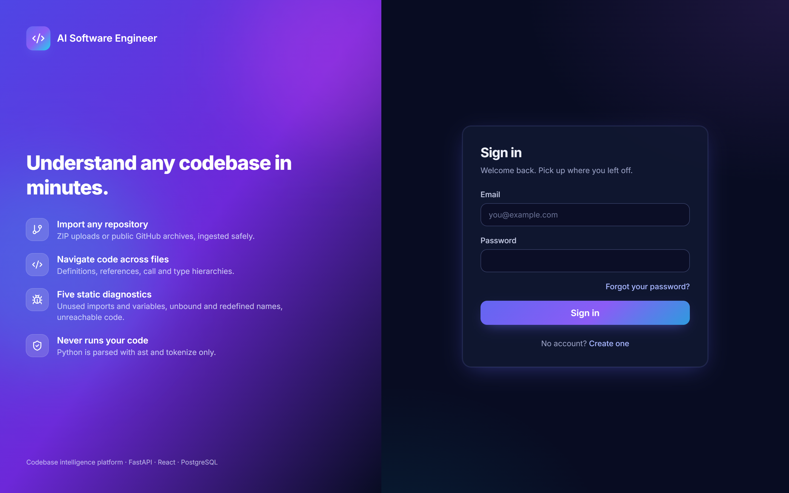
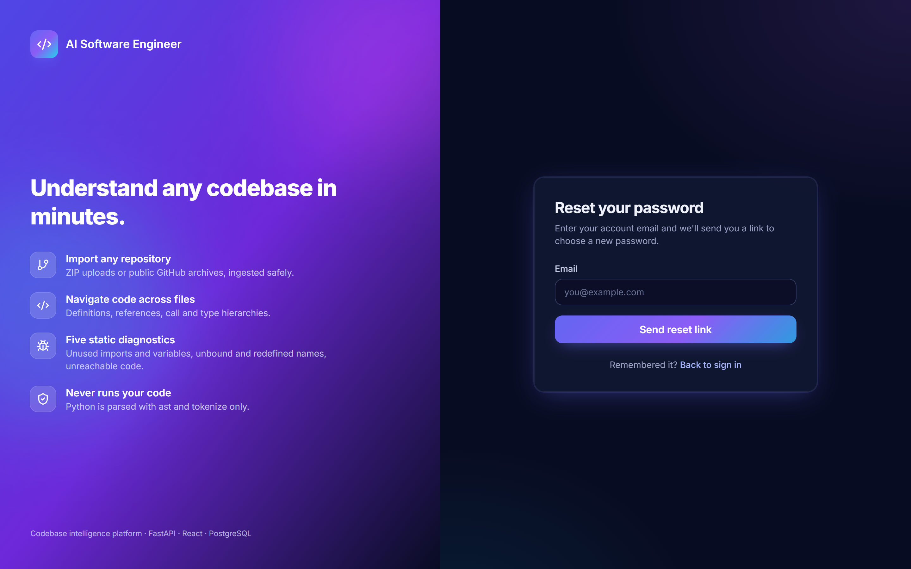
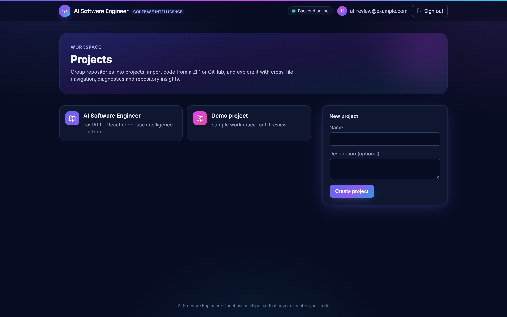
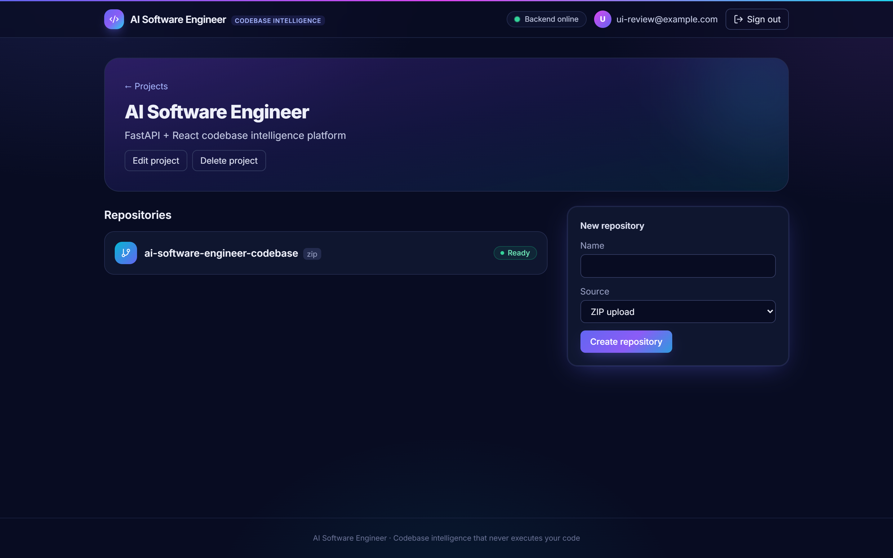
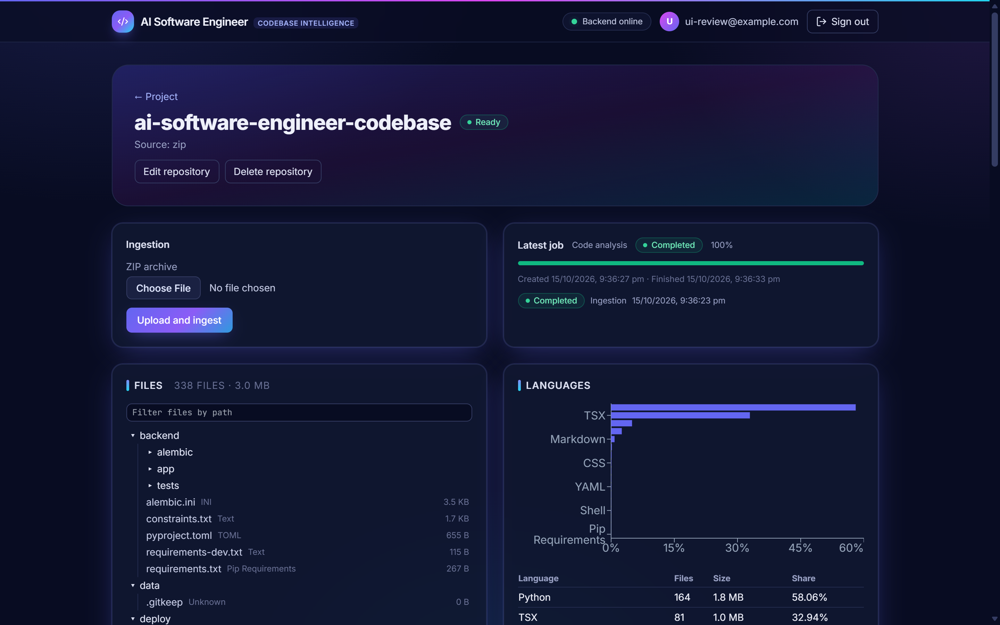
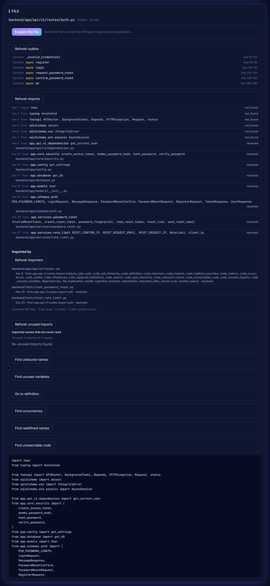
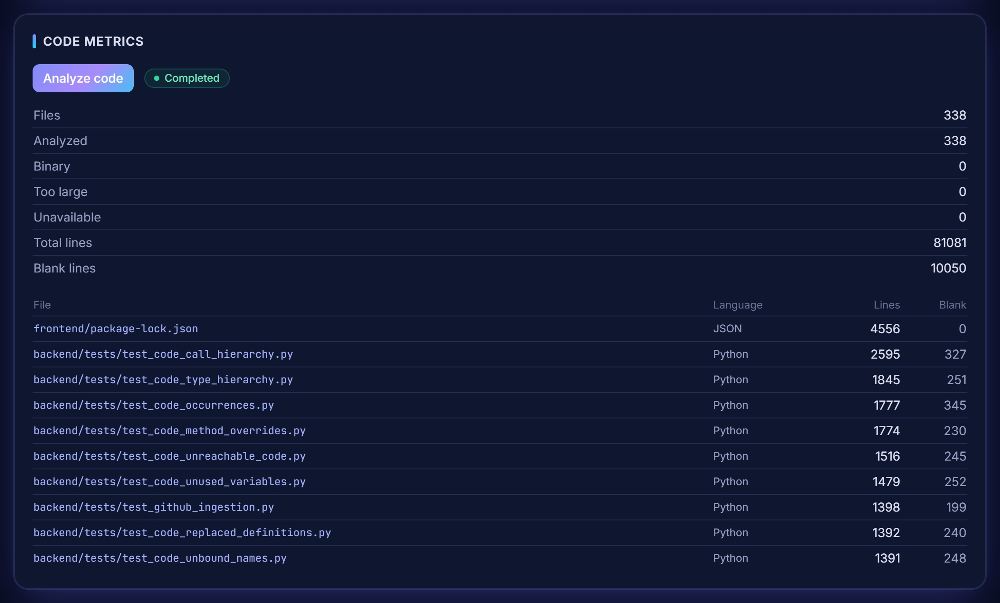

# AI Software Engineer — Codebase Intelligence Platform

**An intelligent codebase analysis platform that helps developers understand software
repositories through static analysis, repository intelligence and AI-assisted code
understanding.**

Self-hosted · FastAPI + React/TypeScript · analyzes Python without ever executing it.

## Overview

Import a repository as a ZIP upload or a public GitHub archive, then explore it in the
browser:
- browse and search the code;
- navigate Python code across files;
- run five static diagnostics;
- review code metrics, declared dependencies and likely committed secrets.

An optional feature explains a single file through Anthropic's API.

Every analysis reads the stored files and parses Python with the standard-library `ast` and
`tokenize` modules. Analyzed code is never executed, imported or compiled to bytecode.

## Problem Statement

Getting to know an unfamiliar codebase is slow. Editor tooling usually needs a local checkout
and a working environment, and some tools run project code (imports, build scripts) to answer
questions. That is a risk when the repository is not trusted. Developers need navigation and
defect signals they can rely on for code they do not trust, with stated limits instead of
guesses.

## Solution

- **Isolated ingestion**: a background worker validates every archive entry before writing
  anything. It then stores a snapshot in which every file has a recorded SHA-256.
- **Static, deterministic analysis**: Python's own parser and tokenizer, with explicit rules.
  Cases the syntax cannot decide are counted separately, never guessed.
- **On demand and protected**: every request is authenticated and ownership-checked, search
  and analyses are rate-limited, and every result links to the exact line.

## Key Features

| Area | Capabilities |
| --- | --- |
| Ingestion | ZIP upload or public GitHub archive; background jobs with status; pending jobs can be cancelled |
| Browsing and search | File tree with a path filter, language statistics, plain-text file viewer, literal code search, exact Python symbol search |
| Code intelligence | Outline, imports, importers, go to definition, find references, name occurrences, call hierarchy, type hierarchy, method overrides |
| Static diagnostics | Unused imports, unbound names, unused variables, redefined names, unreachable code |
| Repository analysis | Code metrics, dependency inventory, secret scan |
| AI (optional) | Explain one file with Anthropic |
| Management | Projects and repositories: create, rename, delete (deleting requires typing the name) |
| Accounts | Register, sign in, and reset a forgotten password through an emailed link (optional, needs SMTP) |

## Architecture

```
Browser: React SPA (Vite dev server, http://127.0.0.1:5173)
   │  /api/v1 (JSON, bearer token), proxied by Vite in development
   ▼
FastAPI on uvicorn (http://127.0.0.1:8000)
   │  authentication → ownership → rate limit (search, analyses) → service
   ├──► PostgreSQL 16: users, projects, repositories, files (with SHA-256),
   │                   analysis jobs, file metrics
   ├──► Redis 7: arq job queue and rate-limit counters
   │      └──► arq worker: ingestion, code metrics, maintenance (every 5 minutes)
   ├──► DATA_DIR/repositories/<repository_id>/: extracted files, read only through
   │                                            the verified reader
   └──► Anthropic API (optional): file explanations
```

**An analysis request**
1. The frontend sends the bearer token with every request to its own `/api/v1`.
2. FastAPI validates the token.
3. The route checks that the project or repository belongs to the user.
4. The route applies the per-user rate limit for search and analyses.
5. The service loads the file snapshot with a single query, then reads files through the
   verified reader and analyzes them in a worker thread.

**An ingestion**
1. The API records a pending job and queues its id (JSON, never pickle).
2. The worker obtains the archive and validates every entry.
3. It extracts into a staging directory.
4. It replaces the file rows and marks the repository ready in one transaction, then swaps
   the staging directory into place.
5. Any failure rolls back and keeps the previous snapshot. A maintenance job recovers stuck
   jobs and removes leftovers.

## Technology Stack

| Layer | Technologies |
| --- | --- |
| Backend | Python 3.12, FastAPI, SQLAlchemy (async, asyncpg), Alembic, PostgreSQL 16, Redis 7, arq, Pydantic, PyJWT, argon2-cffi |
| Frontend | React 18, TypeScript, Vite, Tailwind CSS, TanStack Query, React Router, Axios |
| Analysis | Python standard library: `ast`, `tokenize` (plus `json` and `tomllib` for manifests) |
| Testing | pytest, ruff, mypy, Vitest, Testing Library |
| Local infrastructure | Docker Compose for PostgreSQL and Redis (development only) |

## Security

- **Passwords**: hashed with Argon2 (argon2-cffi).
- **Authentication**: JWT bearer tokens (PyJWT).
  - Signed with `SECRET_KEY` using HS256 by default.
  - The `sub` and `exp` claims are required, and tokens last 60 minutes by default.
  - Every missing or invalid token gets the same 401 response.
- **Session**: the frontend keeps the token in `sessionStorage`, so the session ends when the
  tab closes. The token is attached only to the app's own `/api/v1` requests, and any 401
  clears it.
- **Password reset** (optional, off unless SMTP is configured):
  - The reset link carries a signed token in the URL fragment, so it never reaches server logs.
    The page removes it from the address bar as soon as it is read.
  - Reset tokens use a key derived from `SECRET_KEY` that is separate from sign-in tokens, so
    neither kind can stand in for the other. They expire after 30 minutes by default.
  - Each token is bound to a fingerprint of the current password hash, so it works once and
    stops working when the password changes.
  - Requests get the same answer whether or not the account exists, and the email is sent
    after the response. Requests are limited per IP and per email, confirmations per IP.
  - Without SMTP settings, both endpoints answer 503 "Password reset by email is not
    available".
- **Ownership**: every endpoint that addresses a project or repository checks ownership first.
  Another user's project or repository answers 404 ("Project not found", "Repository not
  found"), exactly like a missing one.
- **Rate limiting**: fixed windows in Redis, updated by atomic Lua scripts. Keys store SHA-256
  digests, never raw user ids, emails or IPs.
  - Search, per-file analyses, secret scans and explanations have per-user limits.
  - Login is limited per IP and per email, registration per IP.
  - Limited requests receive 429 with `Retry-After`.
  - If Redis is unavailable, requests proceed without limits.
- **Verified file reads**: every read checks that the path stays inside the repository
  directory, refuses links and junctions, bounds the size, and compares the SHA-256 recorded at
  ingestion. A mismatch answers 409 "Repository changed during analysis; run it again".
- **Archive safety**: every entry is checked before anything is written.
  - Rejected: absolute, drive, UNC or `..` paths; symbolic links; encrypted or unsupported
    entries; and duplicate or case-colliding paths.
  - Limited: entry count, total and per-file size, and compression ratio (zip bombs).
  - Extraction re-checks the actual sizes and destinations.
- **GitHub downloads**:
  - Only `https://github.com/<owner>/<repository>` is accepted, and the download URL is built
    on the server.
  - Redirects are followed only to GitHub hosts, and every resolved address must be public.
  - The download is size-limited, with no git and no credentials.
- **No repository code execution**: nothing is run, imported or compiled to bytecode.
  Dependency manifests are parsed, never installed.
- **Plain-text rendering**: repository content and every server-provided string are rendered
  as text, never as HTML. External URLs are shown as text, not links.
- **Production exposure**:
  - `/docs`, `/redoc` and `/openapi.json` are disabled when `ENVIRONMENT=production`.
  - CORS accepts exact origins only.
  - `SECRET_KEY` must be at least 32 characters, and the placeholder value is rejected in
    production.
- **Anthropic boundary**: explanations are off unless `ANTHROPIC_API_KEY` is set.
  - Only the requested, verified file (at most 64 KiB) is sent, always to
    `https://api.anthropic.com`.
  - The prompt is fixed on the server and the model gets no tools.
  - Nothing is stored or logged.

## Code Intelligence

Python files only, on demand. Navigation follows imports across the repository's files, within
per-request budgets; results report any truncation.

| Feature | What it does | Scope |
| --- | --- | --- |
| Outline | Classes, functions and methods, each linked to its line | File |
| Imports / importers | Imports resolved to repository files; files that import this one | Cross-file |
| Go to definition | Resolves the selected name through Python's scope rules and imports | Cross-file |
| Find references | Uses of a function or class, each confirmed by resolving it; methods and nested classes are not supported | Cross-file |
| Name occurrences | Every occurrence of the same binding, not just the same spelling | File |
| Call hierarchy | Callers and callees; dynamic calls are counted, not guessed | Cross-file |
| Type hierarchy | Direct bases and direct subclasses | Cross-file |
| Method overrides | Methods this method directly overrides, and direct overrides of it | Cross-file |

There is no type inference: attribute uses such as `self.method()` or `obj.attr` are reported
as unsupported, never guessed.

Search:
- **Code search**: literal and case-insensitive; stops at 5,000 files, 64 MiB or 200 matches.
- **Symbol search**: exact, case-sensitive Python names, up to 200 results.

## Static Diagnostics

Each diagnostic analyzes one Python file and reports only what the syntax proves. Results
link to their lines and are capped at 500 per diagnostic, with exact counts. Files above
256 KiB are not parsed.

| Diagnostic | Reports | Deliberately conservative |
| --- | --- | --- |
| Unused imports | Import bindings whose name nothing in the file reads | Possible package or stub re-exports, dynamic access and string annotations are counted, not listed |
| Unbound names | Names read with no statically known binding | Not a runtime `NameError` detector |
| Unused variables | Assignments to function locals that nothing reads | Not a data-flow analysis |
| Redefined names | `def`, `async def` and `class` statements replaced by a later one of the same name before anything reads them | Decorated definitions, classes with bases, and dynamic scopes are counted only |
| Unreachable code | Statements after `return`, `raise`, `break` or `continue`, after an `if` whose every branch leaves, or after `while True:` without a `break` | Leaving through `try`, `with` or `match`, and calls that never return, are not inferred |

## Repository Analysis

- **Code metrics**: per-file line and blank-line counts. They are computed by a background job
  ("Analyze code") and stored for each snapshot.
- **Dependencies**: declared dependencies from up to 50 manifests (5,000 dependencies):
  - `package.json`;
  - `pyproject.toml` (the PEP 621 `[project]` table);
  - `requirements*.txt`.

  Nothing is resolved, installed or fetched.
- **Secret scan**: seven fixed rules covering AWS access key IDs; GitHub, Slack, Stripe live,
  Google API and Anthropic API keys; and private keys.
  - Findings carry the path, line and rule, never the matched text.
  - It stops at 5,000 files, 64 MiB or 500 findings.
- **Language statistics**: files and bytes per language.

## AI File Explanation

- Optional. Without `ANTHROPIC_API_KEY`, the endpoint answers 503 "AI explanations are not
  configured".
- Sends the verified content of one file (at most 64 KiB) to Anthropic's Messages API, with a
  fixed server-side prompt and no tools. The model is set by `LLM_MODEL` (default
  `claude-opus-5-5`).
- Limited to 20 explanations per user per hour. Review Anthropic's data-retention and privacy
  terms before enabling it.

## Testing & Quality Engineering

Results at the final development commit:

| Check | Result |
| --- | --- |
| Frontend tests (Vitest, Testing Library, jsdom) | 1,214 passing in 37 files |
| Backend tests (pytest) | 2,583 passing in 41 files; 30 skipped on Windows, where creating symlinks needs a privilege |
| TypeScript typecheck and production build | Passing |
| `ruff check` and mypy | Passing |
| Mutation testing | 287/287 mutants caught in the final development phase |

- **Isolation**: frontend tests mock the API at the axios adapter, so no backend is needed.
  Backend database and API tests run against a throwaway, already-migrated PostgreSQL database
  inside rolled-back transactions, and a disposable Redis.
- **Oracles**: diagnostics are cross-checked against CPython's own `symtable` and compiler
  output, run on code the tests write themselves. Seeded random programs drive differential
  tests.
- **Security tests**: every Python analysis has a test that patches `compile`, `exec`, `eval`,
  `subprocess` and sockets to prove repository code never runs. Endpoints are also tested for
  ownership checks, for ownership before rate limiting, and for the 409 answer when the
  snapshot changes.
- **Mutation testing**: each change in the final development phase (redefined names, the
  file-tree filter, unreachable code) was mutation-tested.
  - Every mutant was applied, tested, and the file restored and checked against its SHA-256.
  - Each survivor was either shown to be equivalent and replaced, or answered with a new test.
  - The runners were scratch tooling and are not part of this repository.
  - The 287 figure covers the final phase only, not mutation coverage of the whole application.

## Screenshots

**Sign in**, with a link to reset a forgotten password by email



**Password reset request**



**Projects dashboard**



**Project with its repositories**



**Repository overview**: ingestion status, recent jobs, file tree and language statistics (this
repository analyzing itself)



**Code intelligence on one file**: outline, resolved imports, importers and the unused-imports
diagnostic



**Code metrics**



## Demo

The intended workflow, in about five minutes:

**Login → Project → Repository → Ingestion → Browse → Search → Code Intelligence →
Diagnostics → Repository Analysis → Optional AI Explanation**

1. Sign in, create a project, and add a repository from a ZIP or a public GitHub URL.
2. Start ingestion and watch the job move from pending to completed.
3. Browse the file tree, filter it by path, and search code and symbols.
4. Open a Python file: show its outline, go to a definition in another file, and find
   references.
5. Run the five diagnostics, then review code metrics, dependencies and the secret scan.
6. If configured, explain the file with Anthropic.

<!-- Demo video: add the link to the recorded walkthrough here -->

## Installation

**Requirements**: Python 3.12, Node.js 18 or newer, and Docker (or local PostgreSQL 16 and
Redis 7).

From the repository root:

1. Copy `.env.example` to `backend/.env`, which the backend reads. Copy it again to a
   repository-root `.env`, which Docker Compose reads for the `POSTGRES_*` values.
2. Choose your own local database password and `SECRET_KEY`. Never commit either file.
3. Start PostgreSQL and Redis (development only):
   ```bash
   docker compose up -d postgres redis
   ```

## Environment Variables

The backend reads `backend/.env`; real environment variables override it. Every variable
below exists in the code.

| Variable | Status | Default | Purpose |
| --- | --- | --- | --- |
| `SECRET_KEY` | Required | — | Signs JWTs; at least 32 characters; the placeholder is rejected in production |
| `DATABASE_URL` | Required | — | Must use `postgresql+asyncpg://` (the built-in default is not usable) |
| `ENVIRONMENT` | Optional | `development` | `development`, `test` or `production`; production disables `/docs`, `/redoc` and `/openapi.json` |
| `REDIS_URL` | Optional | `redis://localhost:6379/0` | Job queue and rate limits |
| `CORS_ORIGINS` | Optional | `http://localhost:5173,http://127.0.0.1:5173` | Exact allowed origins; `*` is rejected |
| `DATA_DIR` | Optional | `<repository>/data` | Storage for repositories and uploads |
| `JWT_ALGORITHM` | Optional | `HS256` | `HS256`, `HS384` or `HS512` |
| `JWT_ACCESS_TOKEN_EXPIRE_MINUTES` | Optional | `60` | Token lifetime |
| `MAX_UPLOAD_SIZE_MB` | Optional | `100` | Upload size limit |
| `MAX_ARCHIVE_FILE_COUNT` | Optional | `10000` | Entries per archive |
| `MAX_EXTRACTED_SIZE_MB` | Optional | `500` | Total extracted size |
| `MAX_EXTRACTED_FILE_SIZE_MB` | Optional | `25` | Per-file extracted size (at most `MAX_EXTRACTED_SIZE_MB`) |
| `MAX_COMPRESSION_RATIO` | Optional | `100` | Per-entry compression ratio (zip-bomb guard) |
| `ANTHROPIC_API_KEY` | Optional | empty | Enables AI explanations; empty keeps them disabled |
| `LLM_MODEL` | Optional | `claude-opus-5-5` | Model for explanations |
| `SMTP_HOST` | Optional | empty | Mail server for password-reset emails, such as `smtp.gmail.com`; password reset stays off until `SMTP_HOST`, `SMTP_USERNAME`, `SMTP_PASSWORD`, `SMTP_FROM` and `APP_BASE_URL` are all set |
| `SMTP_PORT` | Optional | `587` | Mail server port; the connection is upgraded with STARTTLS |
| `SMTP_USERNAME`, `SMTP_PASSWORD` | Optional | empty | Mail server login; for Gmail, the address and a Google app password (not the account password) |
| `SMTP_FROM` | Optional | empty | Sender address of reset emails |
| `APP_BASE_URL` | Optional | empty | Public origin of the frontend, such as `http://127.0.0.1:5173`; reset links point to `<APP_BASE_URL>/reset-password` |
| `PASSWORD_RESET_TOKEN_MINUTES` | Optional | `30` | Reset link lifetime (5 to 1,440 minutes) |
| `DEBUG` | Optional, development only | `false` | Logs SQL statements, including bound parameter values; keep it off outside local development |
| `APP_NAME`, `APP_VERSION` | Optional | `AI Software Engineer`, `1.0.0` | Shown in the API title and health responses |
| `API_PREFIX` | Optional | `/api` | API mount prefix; the frontend expects `/api/v1`, so keep the default |
| `POSTGRES_USER`, `POSTGRES_PASSWORD`, `POSTGRES_DB` | Development only (Docker Compose) | — | Required by `docker-compose.yml`; read from the repository-root `.env` or the shell |
| `POSTGRES_PORT` | Development only (Docker Compose) | `5432` | Local PostgreSQL port |
| `TEST_DATABASE_URL`, `TEST_MIGRATION_DATABASE_URL`, `TEST_REDIS_URL` | Tests only | — | See [Testing](#testing) |

## Running the Backend

From `backend/`:
```bash
python -m venv .venv
.venv/Scripts/pip install -r requirements-dev.txt -c constraints.txt
.venv/Scripts/alembic upgrade head
.venv/Scripts/uvicorn app.main:app --reload --host 127.0.0.1 --port 8000
```

In a second terminal, start the worker, which ingestion and code metrics need:
```bash
.venv/Scripts/arq app.workers.worker.WorkerSettings
```

On macOS or Linux, use `.venv/bin/` instead of `.venv/Scripts/`. `constraints.txt` pins every
backend package to the verified versions. In development, the interactive API documentation
is at http://127.0.0.1:8000/docs.

## Running the Frontend

From `frontend/`:
```bash
npm install
npm run dev
```

Open http://127.0.0.1:5173. The dev server proxies `/api` to the backend.

## Testing

**Frontend** (from `frontend/`):
```bash
npm test
npm run typecheck
npm run build
```

**Backend** (from `backend/`):
```bash
.venv/Scripts/python -m pytest
.venv/Scripts/ruff check .
.venv/Scripts/mypy
```

Analysis tests run offline. Database and API tests are skipped unless these variables are
set:
- `TEST_DATABASE_URL`: an already-migrated PostgreSQL database whose name ends in `_test`.
  Every test runs inside a transaction that is rolled back.
- `TEST_MIGRATION_DATABASE_URL`: a separate, disposable database for migration tests.
- `TEST_REDIS_URL`: a loopback Redis with a database index other than 0. The rate-limit tests
  flush it.

## API Overview

All endpoints are under `/api/v1`. Repository endpoints share the prefix
`/projects/{project_id}/repositories/{repository_id}`, written `…` below.
- Per-file endpoints take `?path=<file path>`.
- Go to definition and name occurrences also take `line` and `column`.
- Find references and the three hierarchy endpoints also take `line`.

| Area | Endpoints |
| --- | --- |
| Health | `GET /health`, `GET /api/health`, `GET /api/v1/health` |
| Auth | `POST /auth/register`, `POST /auth/login`, `GET /auth/me`, `POST /auth/password-reset/request`, `POST /auth/password-reset/confirm` |
| Projects | `GET /projects`, `POST /projects`, `GET`/`PATCH`/`DELETE /projects/{project_id}` |
| Repositories | `GET`/`POST /projects/{project_id}/repositories`, `GET`/`PATCH`/`DELETE …` |
| Ingestion and jobs | `POST …/ingest`, `GET …/jobs`, `GET …/jobs/{job_id}`, `POST …/jobs/{job_id}/cancel` |
| Files | `GET …/tree`, `GET …/languages`, `GET …/files/content` |
| Search | `POST …/search` (code), `POST …/symbols/search` |
| Code intelligence | `GET …/files/outline`, `…/files/imports`, `…/files/importers`, `…/files/definition`, `…/files/references`, `…/files/occurrences`, `…/files/call-hierarchy`, `…/files/type-hierarchy`, `…/files/method-overrides` |
| Diagnostics | `GET …/files/unused-imports`, `…/files/unbound-names`, `…/files/unused-variables`, `…/files/replaced-definitions`, `…/files/unreachable-code` |
| Repository analysis | `GET`/`POST …/analysis/code-metrics`, `GET …/analysis/dependencies`, `GET …/analysis/secrets` |
| AI | `POST …/files/explain` |

## Limitations

- **Language**: code intelligence and diagnostics cover Python only, with Python 3.12 syntax.
- **No type inference**: attribute uses such as `self.method()` are reported as unsupported.
  Find references does not support methods or nested classes.
- **Diagnostics are file-level**: each looks at one file, and files above 256 KiB are not
  parsed.
- **GitHub import**: public repositories only.
- **Repositories**: the source cannot be changed after creation. Re-ingest to refresh the
  files, or create a new repository.
- **Sessions**: there are no refresh tokens. A session ends when the tab closes or the token
  expires. Resetting a password does not end sessions that are already signed in.
- **Navigation**: files and lines are not reflected in the URL, so they cannot be shared as
  links.
- **Tooling**: there is no CI pipeline yet, and ESLint is not installed, so `npm run lint`
  fails.
- **Bundle size**: the main frontend bundle is about 739 kB, above Vite's 500 kB warning.
- **Deployment**: production deployment is not the current goal. This is a single-node
  development setup, and `docker-compose.yml` is for local development only.

## Future Scope

Planned future work, not yet implemented:
- A CI pipeline: tests, typecheck, ruff, mypy and ESLint.
- Shareable links to a file and line.
- A repository-wide diagnostics dashboard.
- An import graph view.
- Type-informed references, such as method references.
- Refresh tokens.
- Frontend bundle optimization (code splitting).

## License

Released under the [MIT License](LICENSE).
